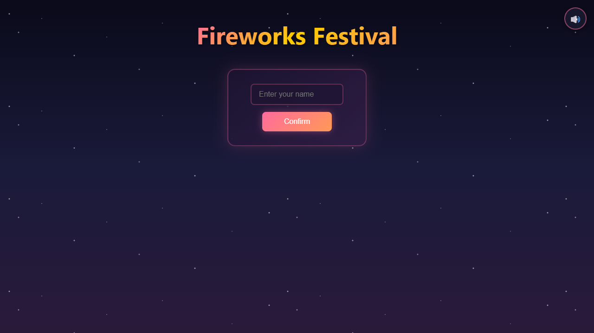

# Fireworks Festival

같은 크기의 폭죽을 부딪쳐 더 큰 폭죽으로 키우는 온라인 협동 합치기 게임 (1~10명, PC · 모바일).

## 플레이

**https://multi-suika-game.web.app** — 브라우저에서 바로. 닉네임을 정하고 방을 만들거나 참가, 방장이 시작.

## 규칙

- 턴제 — 자기 차례(10초)에 화면 아래 발사대에서 **새총처럼 당겼다 놓아** 폭죽을 위로 쏜다
- 폭죽은 위로 떠올라 **천장에 쌓인다**
- 같은 크기 두 개가 부딪치면 합쳐져 한 단계 큰 폭죽이 된다 (크기 1 → 10)
- 크기 10 두 개가 합쳐지면 터지며 사라지고, 주변 폭죽을 충격파로 밀어낸다
- 쌓인 폭죽이 아래쪽 위험선까지 내려와 2초 넘게 머물면 게임 종료

## 점수

- 합칠 때마다 점수 (큰 폭죽일수록 높다)
- **최종 점수 = 파티 점수(전원 합계) × 인원 배율** — 배율 = 1 + ln(인원) / ln(10)

| 인원 | 1 | 2 | 3 | 4 | 5 | 6 | 7 | 8 | 9 | 10 |
|---|---|---|---|---|---|---|---|---|---|---|
| 배율 | x1.00 | x1.30 | x1.48 | x1.60 | x1.70 | x1.78 | x1.85 | x1.90 | x1.95 | x2.00 |

오른쪽 위 🔊에서 배경음악 · 효과음 조절.

## 문의

버그 · 제안은 [Issues](../../issues)에.
